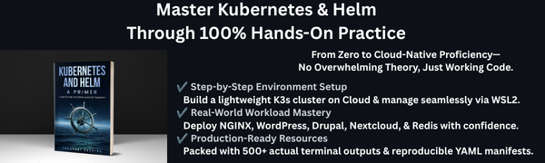

# Book "Kubernetes-and-Helm-A-Primer" - Repository
Official YAML manifests and files for the book titled "[Kubernetes and Helm: A Primer](https://www.amazon.com/dp/B0HQ5QPP5L)"

<p align="center">
  <a href="https://www.amazon.com/dp/B0HQ5QPP5L" target="_blank">
    
  </a>
</p>

## 1. Book information
📖 **Want to master the deployment and hands-on architecture behind these manifests?**  
Check out the complete over 500-page book for this repository: **[Kubernetes and Helm: A Primer on Amazon ($6.99 Launch Price)](https://www.amazon.com/dp/B0HQ5QPP5L)**

[](https://www.amazon.com/dp/B0HQ5QPP5L)

👉 **[Get your copy on Amazon.com](https://www.amazon.com/dp/B0HQ5QPP5L)**

## 2. Repository Structure
This repository contains the configuration files and deployment manifests accompanying the book ***Kubernetes and Helm: A Primer***. Below is an overview of the directory structure and root files:

```text
.
├── conf/         # Kubernetes YAML manifests and Helm values.yaml organized by chapter
├── ERRATA.md     # List of known corrections, updates, and clarifications for the book
├── LICENSE       # Licensing terms for the contents of this repository
├── NOTICE        # Third-party copyright notices and attributions
└── README.md     # This file
```

## 3. Found an Error?
If you notice a typo or a broken command, please submit an issue on this repository or check **[ERRATA.md](ERRATA.md)** for the latest updates.

​Purchasers of this eBook can update to the latest version anytime under "**Manage Your Content and Devices**" on Amazon.


## 4. License
This project is licensed under the Apache License 2.0 - see the [LICENSE](LICENSE) file for details.

## 5. Third-Party Attributions & Licenses
This repository contains modified configuration files (values.yaml) based on open-source projects:
- **Bitnami Helm Charts (`values.yaml`)**
  - **Original Copyright**: Copyright Broadcom, Inc. All Rights Reserved.
  - **License**: [Apache License 2.0](https://www.apache.org/licenses/LICENSE-2.0)
  - **Modifications**: Customized parameters and configuration defaults specifically tuned for the examples in *Kubernetes and Helm: A Primer*.
